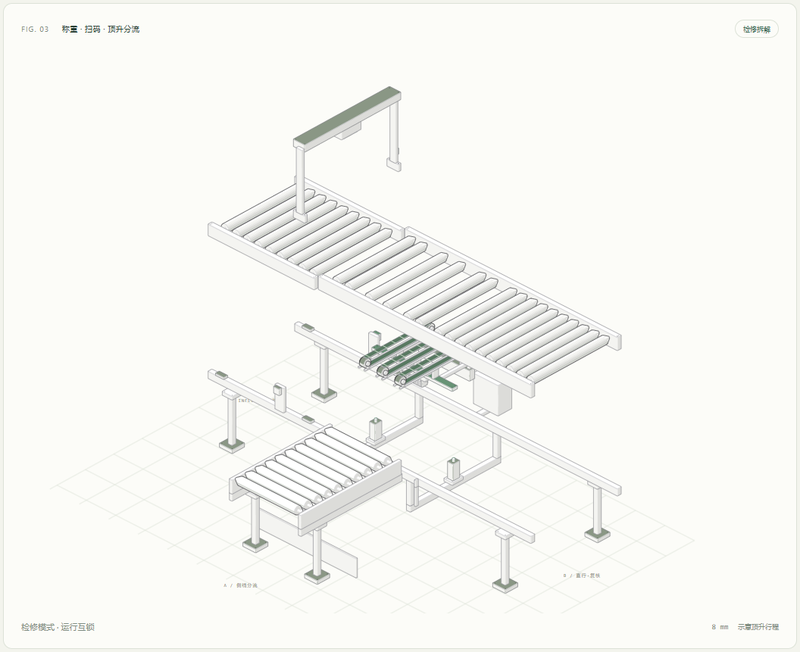

# Try-3D · 流转机械原理实验

三个可离线运行的等轴测交互案例，探索 Anatomy 绘图库与技能流程能如何迁移到独立设计。

| 案例 | 入口 | 内容 |
| --- | --- | --- |
| 快递传送带 | [index.html](index.html) | 主线输送、扫码与三个目的地分流 |
| 火箭发动机 | [raptor-light.html](raptor-light.html) | Anatomy 官方案例的中文导览版 |
| 顶升分拣模块 | [sorter.html](sorter.html) | 独立设计的称重、扫码、顶升、侧移与拆解 |

下载或克隆仓库后，用浏览器打开上述 HTML。GitHub 仓库中的 HTML 文件默认显示源码。



第三方来源及许可见 [THIRD_PARTY_NOTICES.md](THIRD_PARTY_NOTICES.md)。

## 快递分拣传送带

可交互的等轴测快递分拣演示：主线输送、扫码识别、三个目的地出口，支持暂停、速度调节、自动与手动投件、包裹查看、运行统计和深浅主题。

直接用浏览器打开 `index.html` 即可，不依赖网络、后端、字体 CDN 或第三方运行时。

## 开发

Node.js 20.10+。无需安装 npm 依赖。

```sh
npm run build
npm test
npm start
```

本地预览：http://127.0.0.1:4173

## 操作

- 空格：暂停 / 继续
- N：添加所选目的地包裹
- 左右方向键：调节速度
- 点击或使用 Tab + Enter 选择包裹：查看运单与状态
- 系统设置减少动态效果时默认暂停，可手动启动

## 模型说明

主线与支线按相同示意速度移动，扫码阈值、出口位置和统计来自 `src/model.mjs`。采用理想化转向分流与固定投件间距；不模拟实际扫码失败、设备故障、碰撞力学或工业 PLC 控制。配色表示目的地。页面不是工业控制系统，也不是设备工程图。

`src/app.js` 使用 Anatomy 的坐标投影与 SVG 实体绘图函数；`scripts/build.mjs` 把模型、绘图库与页面样式内联到独立 HTML。

## 开源依赖

Anatomy by Ryan：https://github.com/wheresryan22/anatomy 。选用的源文件位于 `vendor/anatomy`，按 MIT 许可保留其 LICENSE。生成的 HTML 亦包含依赖的版权声明。

## Anatomy 标杆案例：火箭发动机

`raptor.html` 和 `raptor-light.html` 是官方 Raptor Engine 示例的中文导览版本。原始项目完整保存在 `reference/anatomy-main`，使用其几何、拆解弹簧、遮挡排序、SVG + WebGL 着色器与审计机制。这里增加中文组件名称、操作说明和来源声明，不把原作者作品标为原创。

```sh
node scripts/build-raptor.mjs
node scripts/serve-case.mjs
```

本地预览：http://127.0.0.1:4174 。可离线打开 HTML。空格拆解 / 组装，方向键选择组件，I 点火 / 关闭，Esc 收起。图中数值沿用原案例的示意模型，不作为工程数据。

## 原创案例：顶升式快递分拣模块

`sorter.html` 是独立设计的机械结构与运行逻辑，使用 Anatomy 的圆件、实体、管线、真实形状记录与几何审计工具；没有使用发动机或其他官方示例的整机几何。

```sh
npm run build:sorter
npm run audit:sorter
npm run start:sorter
```

打开 http://127.0.0.1:4175/sorter.html ，或离线打开 HTML。

- 流程：入口滚筒输送 → 静态称重 → 扫码 → 定位 → 顶升横向皮带 → 侧移 → 回落。
- 新包裹参数：重量、目的地、自动投件间隔；已入队包裹保留自己的运单。
- 超重包裹与 B 目的地包裹沿主线直行，分别统计。
- 单步：执行到下一个阶段边界并暂停；初始等待阶段的第一步放行一件包裹。
- 拆解：扫码门、盖板、称重台、滚筒、皮带盒错开离开；执行器保留当时行程。
- 互锁：拆解时暂停运行；点击运行先重新组装，再继续之前的阶段。
- 键盘：空格运行 / 暂停，E 拆解 / 组装，N 入件，右箭头单步，Esc 收起。

设计与零件清单位于 `sorter/DESIGN.md`；状态机位于 `sorter/model.mjs`；几何位于 `sorter/geometry.mjs`。审计结果保存于 `logs/sorter-audit.txt`。模拟不含真实 PLC、摩擦、扫码失败、应力计算或称重误差；15 kg 阈值与时间、速度、行程均为教学设定。

重建原始几何并审计：

```sh
node reference/anatomy-main/examples/raptor-engine/build.mjs --light --audit
```
